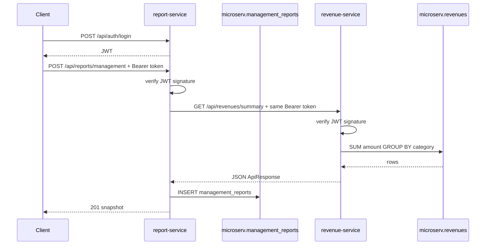

# Revenue and management reports

A small Spring Boot lab: two services, an in-memory H2 database inside each process, and one shared library. The services use different tables. The management report service does not read the revenue table. It asks the revenue service over HTTP, then stores its own snapshot.

The full write-up is in [doc/README.md](doc/README.md): architecture, API, data, and the runbook.

```text
curl
  |  POST /api/auth/login          username + password
  |  <-- JWT
  |  POST /api/reports/management  Authorization: Bearer <token>
  v
report-service :8082 ---- checks the token signature with the shared secret
  |                        JDBC / report-pool ----> microserv.management_reports
  |  GET /api/revenues/summary
  |  headers: Authorization (same token), X-Request-Id
  v
revenue-service :8081 ---- checks the same signature again
                           JDBC / revenue-pool ----> microserv.revenues

common-lib is a jar inside both processes. It is not a third server.
The JWT secret is shared config, not a call between the services.
```



## What is shared, and what is not

Shared code lives in `common-lib`:

- `ApiResponse` so both APIs return `{ "responseCode", "responseMessage", "responseBody" }`
- `RevenueSummary`, the JSON both sides agree on
- `GlobalExceptionHandler` so 400, 404, and 502 look the same
- `RequestIdFilter` so one user action has one id in both logs
- `JwtService`, `JwtAuthFilter`, and `AuthController` so both services sign and check the same token
- `application-datasource.yml` and `schema.sql`, the in-memory H2 connection and the table definitions
- `application-auth.yml`, the shared JWT secret and the one lab user `learner` / `learner`

Each service still builds its own Hikari pool at startup. The shared file is configuration loaded into each process. H2 memory is private to that process, so the two services do not see each other's rows. They share data only through the HTTP call.

| Service | Port | Pool | Tables |
| --- | --- | --- | --- |
| revenue-service | 8081 | `revenue-pool` | `revenues` |
| report-service | 8082 | `report-pool` | `management_reports` |

Each service writes its own SQL. `RevenueDao` queries `revenues`. `ManagementReportDao` queries `management_reports`. A `RowMapper` turns each `ResultSet` row into the object the API returns.

`report-service` does not depend on the `revenue-service` jar. It depends only on `common-lib`, then calls the revenue API.

## Read the code in this order

1. `common-lib/src/main/resources/application-datasource.yml` — the H2 connection. Each service imports it and adds only its pool name. `schema.sql` creates the tables when the process starts. `revenue-service/src/main/resources/data.sql` loads the sample rows.
2. `revenue-service/src/main/resources/application.yml` and the report service copy.
3. The rest of `common-lib` — the envelope, the summary contract, errors, the request id, and JWT (`JwtService`, `JwtAuthFilter`, `AuthController`).
4. `RevenueServiceApplication` — `scanBasePackages` includes `com.learn.common`, or the shared filter and error handler are never loaded.
5. `RevenueDao` and `RevenueRowMapper` — the SQL and the row mapping. Then `RevenueService` and `RevenueController`.
6. `RevenueClient` — the HTTP call. It copies `Authorization` and `X-Request-Id` from the incoming request. Then `ManagementReportDao` and `ManagementReportRowMapper`. The HTTP call finishes before the insert, so a pool connection is not held while waiting on the other service.
7. `ReportServiceApplication` — same scan idea, different packages.

## Run it

Java 21 is required. Maven Wrapper is included, so a global Maven install is not required. No database server is required. H2 starts inside each service.

From this folder:

```powershell
.\mvnw.cmd test
```

Start each service from the project root in its own terminal. `-am` builds `common-lib` first.

```powershell
.\mvnw.cmd -pl revenue-service -am spring-boot:run
```

```powershell
.\mvnw.cmd -pl report-service -am spring-boot:run
```

Wait until both logs say the application started. Health does not need a token. Every `/api` call except login does.

```powershell
curl.exe -s "http://localhost:8081/actuator/health"
curl.exe -s "http://localhost:8082/actuator/health"
$login = Invoke-RestMethod -Method Post -Uri http://localhost:8081/api/auth/login -ContentType "application/json" -Body '{"username":"learner","password":"learner"}'
$token = $login.responseBody.token
curl.exe -s -H "Authorization: Bearer $token" "http://localhost:8081/api/revenues/summary?from=2026-01-01&to=2026-01-31"
Invoke-RestMethod -Method Post -Uri http://localhost:8082/api/reports/management -ContentType "application/json" -Headers @{ Authorization = "Bearer $token"; "X-Request-Id" = "learn-demo-1" } -Body '{"from":"2026-01-01","to":"2026-01-31"}'
curl.exe -s -H "Authorization: Bearer $token" http://localhost:8082/api/reports
```

On startup the revenue service loads four sample rows: January subscriptions `1200.00` plus ads `300.00` (`1500.00 USD`), and February subscriptions `1500.00` plus services `800.00` (`2300.00`). January 1 through February 28 is `3800.00`. The report service loads two saved reports for those same periods, so `GET /api/reports` is not empty.

`Invoke-RestMethod` is used for JSON bodies because PowerShell removes quotes before they reach `curl.exe`. GET calls can stay on `curl.exe`. The response header `X-Request-Id` is `learn-demo-1`, and the same value is in square brackets in both service consoles.

The rows live only while that service is running. Open the H2 console for the revenue service at `http://localhost:8081/h2-console`, or the report service at `http://localhost:8082/h2-console`. Use JDBC URL `jdbc:h2:mem:microserv`, user `sa`, and an empty password. The URL must match exactly, or the console opens a different empty database.

## What one report request does

1. You call `POST /api/auth/login` on either service with `learner` / `learner`. `AuthController` checks that password, then `JwtService` signs a token. The token holds the username and an expiry. The password stays on the server.
2. You call report-service with `Authorization: Bearer <token>`.
3. `JwtAuthFilter` in report-service checks the signature with the shared secret. A bad or missing token stops here with **401**. Revenue is not called.
4. `ManagementReportController` checks that `from` and `to` are present.
5. `ManagementReportService` checks that `from` is not after `to`.
6. `RevenueClient` sends `GET http://localhost:8081/api/revenues/summary` and copies both `Authorization` and `X-Request-Id`. It does not log in again and it does not ask revenue "who is this user?".
7. `JwtAuthFilter` in revenue-service checks the same signature with the same secret. Then `RevenueService` runs two queries on the `revenues` table: sum by category, and distinct currencies.
8. The revenue service answers with `ApiResponse` wrapping `RevenueSummary`. It never hears about reports.
9. If that call fails, report-service returns **502** and does not insert a row.
10. If it succeeds, report-service writes one row in `management_reports`. The narrative and the category JSON are a snapshot. Later edits to `revenues` do not change old reports.
11. The client gets **201** and the saved report.

A token from port 8081 works on port 8082, and the other way around, because both processes import `application-auth.yml`. They never call each other to validate it. The shared secret is what makes the signature mean the same thing in both places.

## HTTP map

Both services:

- `POST /api/auth/login` with `{ "username": "learner", "password": "learner" }` — no token required

Revenue service:

- `POST /api/revenues`
- `GET /api/revenues`
- `GET /api/revenues?from=2026-01-01&to=2026-01-31`
- `GET /api/revenues/summary?from=2026-01-01&to=2026-01-31`
- `GET /api/revenues/{id}`

Report service:

- `POST /api/reports/management` with `{ "from": "2026-01-01", "to": "2026-01-31" }`
- `GET /api/reports`
- `GET /api/reports/{id}`

Status codes used here: **201** created, **400** bad input, **401** missing or invalid token, **404** missing id, **502** the other service failed. An unknown failure is **500** with the message `Unexpected error` and the stack trace only in the server log. `/actuator/health` stays open.

## Experiments

1. Generate the January report twice. `GET /api/reports` shows two rows with the same total. Each call stores a new snapshot.
2. Add a March row:

   ```powershell
   Invoke-RestMethod -Method Post -Uri http://localhost:8081/api/revenues -ContentType "application/json" -Headers @{ Authorization = "Bearer $token" } -Body '{"source":"store","category":"ads","amount":25.50,"currency":"usd","recordedOn":"2026-03-04","note":"counter"}'
   ```

   Generate a report for March. The old January row in `management_reports` stays `1500.00`.
3. Stop the revenue terminal and generate a report again. You get 502, and no new report row.
4. Call summary with `from=2026-02-01&to=2026-01-01`. You get 400, and the revenue log shows the id, but it does not run the SQL. The range is rejected first.
5. Omit `amount` from a create body. You get 400 and `Validation failed`.

## Reset the tables

Stop the service and start it again. The memory database is created empty, `schema.sql` builds the tables, and the revenue service loads `data.sql` again. Rows added through the API are gone after that restart.

## What this lab leaves out

An API gateway would sit on one port and forward `/api/revenues` to 8081 and `/api/reports` to 8082. It is not here, so you can see the two hops.

A message queue would let report-service ask for a summary and answer the client later. This lab uses a synchronous call: the report request waits until revenue responds or the 2 second connect / 3 second read timeout fires.

A third service would repeat the same pattern: its own tables, its own SQL and `RowMapper`, a client class for each service it calls, and a dependency only on `common-lib` plus its own code. It would import the same `application-auth.yml`, so the existing tokens would work there too.
