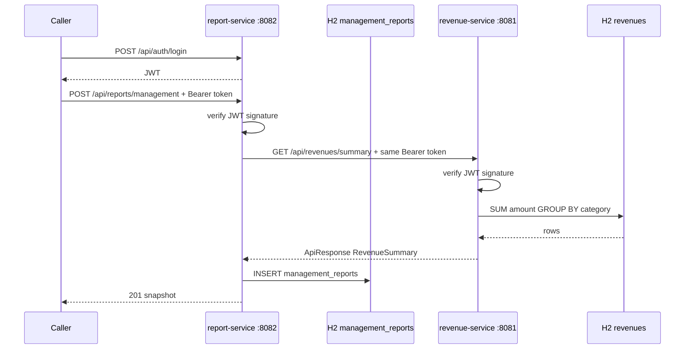

# Architecture

Parent Maven project: `com.learn:microserv:1.0.0`. Spring Boot `3.5.16`. Java 21.

| Module | Kind | Port | What it owns |
| --- | --- | --- | --- |
| `common-lib` | jar, not a server | none | Envelope, summary contract, JWT, errors, request id, shared YAML, `schema.sql` |
| `revenue-service` | Spring Boot jar | 8081 | Revenue HTTP API, `RevenueDao`, table `revenues`, pool `revenue-pool` |
| `report-service` | Spring Boot jar | 8082 | Report HTTP API, `RevenueClient`, table `management_reports`, pool `report-pool` |

`report-service` depends on `common-lib` only. It does not depend on the `revenue-service` jar. The revenue address is configuration: `clients.revenue.base-url`.

Both applications scan `com.learn.common` as well as their own package. That scan is what loads `JwtAuthFilter`, `AuthController`, `GlobalExceptionHandler`, and `RequestIdFilter`.

## Runtime path



One report request, in order:

1. The caller logs in on either port with `learner` / `learner`. `AuthController` checks the password. `JwtService` signs a token. The token holds the username and a 60 minute expiry. The password stays on the server.
2. The caller calls report-service with `Authorization: Bearer <token>`.
3. `JwtAuthFilter` in report-service checks the signature. A missing or bad token returns **401**. Revenue is not called.
4. `ManagementReportController` requires `from` and `to`.
5. `ManagementReportService` rejects a range where `from` is after `to` with **400**, before any HTTP or SQL.
6. `RevenueClient` sends `GET http://localhost:8081/api/revenues/summary` and copies `Authorization` and `X-Request-Id`. Connect timeout is 2 seconds. Read timeout is 3 seconds. It does not log in again.
7. `JwtAuthFilter` in revenue-service checks the same signature. `RevenueDao` sums `amount` by `category` and reads distinct currencies. `RevenueRowMapper` and `CategoryAmountRowMapper` turn rows into objects.
8. Revenue answers with `ApiResponse` wrapping `RevenueSummary`. It does not know a report is being stored.
9. If that call fails, report-service returns **502** and does not insert a row.
10. If it succeeds, report-service inserts one `management_reports` row. The narrative and the category JSON are a snapshot. Later edits to `revenues` do not change old reports.
11. The caller receives **201**.

The HTTP call finishes before the insert, so a pool connection is not held while waiting on the other service.

## How the token is shared

There is no auth server and no token table. Both processes import `application-auth.yml`.

| Setting | Value in this lab |
| --- | --- |
| `auth.jwt.secret` | shared HMAC key, at least 32 bytes |
| `auth.jwt.ttl-minutes` | 60 |
| `auth.user.username` | `learner` |
| `auth.user.password` | `learner` |

A token created on port 8081 is valid on port 8082, and the other way around, because both sides verify the signature with that same secret. They never call each other to ask who the user is.

Report forwards the caller's `Authorization` header. If that header is missing, report itself returns **401** and does not call revenue.

`/api/auth/login` and `/actuator/health` do not require a token. Every other `/api` route does. The H2 console at `/h2-console` is also outside `/api`.

## Request id

`RequestIdFilter` reads `X-Request-Id`. If the header is missing or not a short token of letters, digits, and hyphens, the filter creates a UUID. The same value is written on the response and into the log as `[requestId]`. `RevenueClient` copies the current id, so one user action shows the same id in both consoles.

## What must match if the services are split

| Must be the same | Can differ |
| --- | --- |
| `auth.jwt.secret` | Port |
| Login user, if both services should issue tokens | Pool name |
| `RevenueSummary` and `CategoryAmount` field names | Tables and SQL |
| `ApiResponse` field names: `responseCode`, `responseMessage`, `responseBody` | Seed data |
| | `clients.revenue.base-url` on the report side |

## Deployment

`common-lib` is published as a jar and then packaged inside each service fat jar (`BOOT-INF/lib`). It has no `main` method and no port.

Each service is its own process:

```text
common-lib jar
    | compile dependency          | compile dependency
    v                             v
revenue-service jar           report-service jar
    | deploy alone                  | deploy alone
    v                             v
Host A :8081                  Host B :8082
H2 revenues                   H2 management_reports
        ^                         |
        | GET /api/revenues/summary
        +-------------------------+
```

Build `common-lib` first. Then build and start either service without rebuilding the other. `-am` on the Maven command builds the library as part of that service's build.

```powershell
.\mvnw.cmd -pl revenue-service -am package
.\mvnw.cmd -pl report-service -am package
java -jar revenue-service\target\revenue-service-1.0.0.jar
java -jar report-service\target\report-service-1.0.0.jar
```

This lab runs both jars on one computer. Moving them to two machines changes the host in `clients.revenue.base-url` and the machine where each jar is started. Each process still has its own H2 database. They do not share rows.

A change to `common-lib` reaches a host only when that service is built and deployed again. Restarting report-service does not restart revenue-service.

If revenue is down or returns an error, report-service answers **502** and writes no report row.

## Code map

Read in this order:

1. `common-lib/src/main/resources/application-datasource.yml` and `application-auth.yml`
2. `common-lib/src/main/resources/schema.sql`
3. `common-lib` Java: `ApiResponse`, `RevenueSummary`, `JwtService`, `JwtAuthFilter`, `AuthController`, `GlobalExceptionHandler`, `RequestIdFilter`
4. `revenue-service`: `RevenueDao`, `RevenueRowMapper`, `RevenueService`, `RevenueController`
5. `report-service`: `RevenueClient`, `ManagementReportDao`, `ManagementReportRowMapper`, `ManagementReportService`, `ManagementReportController`

Inside every service the call stack is the same: filter, controller, service, DAO, `RowMapper`, JDBC.
